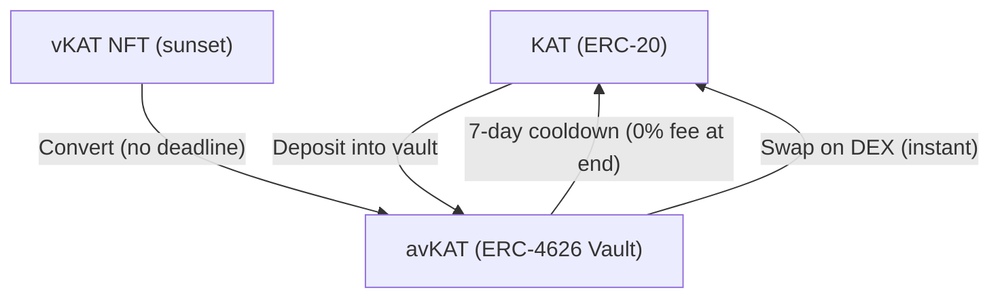

# Understanding the KAT Token Ecosystem

This guide introduces the KAT tokens you will encounter when staking on Katana
and how they relate to each other. Read it before the step-by-step tutorials
that follow.

## The Two Token Types

### KAT — The Core Token (ERC-20)

KAT is a standard ERC-20 token and the native token of Katana. It is fungible,
transferable, and can be held in any Ethereum-compatible wallet.

| Property | Value |
|----------|-------|
| **Standard** | ERC-20 |
| **Contract** | `0x7f1f4b4b29f5058fa32cc7a97141b8d7e5abdc2d` |
| **Decimals** | 18 |
| **Transferable** | Yes |

### avKAT — Staked KAT (ERC-4626 Vault)

When you deposit KAT into the avKAT vault, the vault issues **avKAT** tokens,
a liquid, transferable ERC-4626 token representing a proportional percentage
of the vault's staked position.

| Property | Value |
|----------|-------|
| **Standard** | ERC-4626 (Tokenized Vault) |
| **Contract** | `0x7231dbaCdFc968E07656D12389AB20De82FbfCeB` |
| **Transferable** | Yes |
| **Rewards** | Automatic, compounded every epoch |
| **Exit** | 7-day cooldown (fee-free after the full cooldown), or swap on a DEX |

A share of the revenue from Katana Swap, Katana Perps, Vault Bridge and
sequencer fees is used to buy KAT on the open market. 100% of that KAT is
compounded into avKAT every epoch.

Key characteristics:

- avKAT is a liquid ERC-4626 token. You can transfer it, trade it, or use it in DeFi
- The exchange rate between avKAT and KAT reflects the bought-back KAT compounded into the vault
- No claiming or restaking is required
- You can unstake through a 7-day cooldown with no fee if you wait the full period
- You can exit early with a fee that starts at 25% and goes down every day
- You can swap avKAT for KAT on a DEX at the market rate

## How the Tokens Connect

## Exiting

| Exit path | Time | Fee |
|---|---|---|
| **Full cooldown** | 7 days | 0% |
| **Early exit** | 1–6 days | 21% down to 4% |
| **Instant exit** | Instant | 25% |
| **Swap on DEX** | Instant | Market rate, trading fees and slippage |

See [Unstake and Exit](kat-unstake-and-exit.md) for the full fee schedule and code.

## Contract Addresses Reference

The avKAT vault is built on the same contracts as before. Under the hood, the
vault holds KAT in the VotingEscrow, and exits go through the Exit Queue.

| Contract | Address | Purpose |
|----------|---------|---------|
| KAT | `0x7f1f4b4b29f5058fa32cc7a97141b8d7e5abdc2d` | Core ERC-20 token |
| avKAT Vault | `0x7231dbaCdFc968E07656D12389AB20De82FbfCeB` | ERC-4626 vault |
| VotingEscrow | `0x4d6fC15Ca6258b168225D283262743C623c13Ead` | Lock management, used for exits |
| NFT Lock | `0x106F7D67Ea25Cb9eFf5064CF604ebf6259Ff296d` | vKAT NFT contract |
| Exit Queue | `0x6dE9cAAb658C744aD337Ca5d92D084c97ffF578d` | Withdrawal queue |
| CompoundStrategy | `0x60233D1c150F9C08D886906d597aA79a205b0463` | Vault reward reinvestment |
| Clock | `0x17049d374A2bcdA70F8939C21ad92bcF6B2A95ab` | Epoch timing |

!!! info "vKAT was sunset on November 17, 2026"
    vKAT staking, gauge voting and vote incentives ended on November 17, 2026.
    avKAT is now the way to stake KAT. If you hold vKAT, you can
    [convert it to avKAT](kat-convert-vkat-to-avkat.md) at any time.

## What's Next

1. [Stake KAT to avKAT](kat-deposit-to-avkat.md) — Deposit KAT into the avKAT vault
2. [Convert vKAT to avKAT](kat-convert-vkat-to-avkat.md) — Move a sunset vKAT position into avKAT
3. [Unstake and Exit](kat-unstake-and-exit.md) — Withdraw your KAT, with exit fee details

Guides for vKAT staking, gauge voting and claiming voting incentives are kept
for reference under **Sunset** at the bottom of the navigation.
