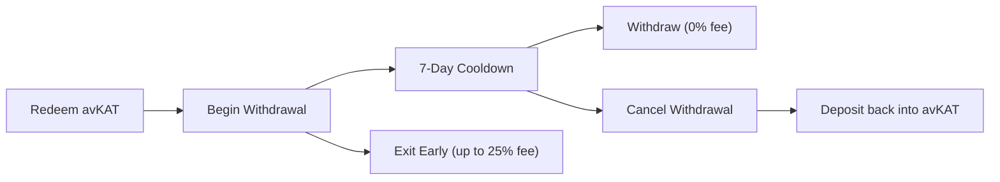

# Unstake and Exit

This tutorial covers all the ways to exit a KAT staking position, including
the 7-day cooldown, the exit fee schedule, and the instant exit options.

## Goal

By the end of this tutorial, you'll understand:

- The 7-day cooldown and how the exit fee goes down each day
- How to unstake avKAT through the vault
- How to begin, complete, or cancel a withdrawal
- How to exit instantly, either through the vault or by swapping on a DEX
- How to exit a remaining vKAT NFT
- How exit fees are calculated

## Prerequisites

- avKAT tokens, or a vKAT NFT from before the November 17, 2026 sunset

## Exit Fee Schedule

Unstaking starts a **7-day cooldown**. If you wait the full cooldown, there is
**no exit fee**. If you withdraw earlier, you pay a fee that starts at 25% and
goes down every day until it reaches 0%.

| Time left in cooldown | Fee | Example (1,000 KAT) |
|---|---|---|
| **7 days** (instant exit) | 25% | Receive 750 KAT |
| **6 days** | 21% | Receive 790 KAT |
| **5 days** | 18% | Receive 820 KAT |
| **4 days** | 14% | Receive 860 KAT |
| **3 days** | 11% | Receive 890 KAT |
| **2 days** | 7% | Receive 930 KAT |
| **1 day** | 4% | Receive 960 KAT |
| **Cooldown complete** | 0% | Receive 1,000 KAT |

The fee decreases linearly over the cooldown:

```
feePercent = 25% × (1 - daysWaited / 7)
received = amount × (1 - feePercent)
```

Key constants:

```typescript
const EXIT_FEE = {
  MIN_FEE_BPS: 0n,              // 0% (after the full 7 days)
  MAX_FEE_BPS: 2500n,           // 25% (immediate)
  COOLDOWN_PERIOD: 604_800,     // 7 days in seconds
  BPS_DENOMINATOR: 10_000n,
};
```



## Contract Addresses

The avKAT vault uses the same contracts as before. Exits go through the
VotingEscrow and the Exit Queue.

```typescript
const VOTING_ESCROW = "0x4d6fC15Ca6258b168225D283262743C623c13Ead";
const VAULT = "0x7231dbaCdFc968E07656D12389AB20De82FbfCeB";
const EXIT_QUEUE = "0x6dE9cAAb658C744aD337Ca5d92D084c97ffF578d";
```

## ABIs

??? note "VotingEscrow ABI (click to expand)"

    ```typescript
    const votingEscrowAbi = [
      {
        name: "beginWithdrawal",
        type: "function",
        stateMutability: "nonpayable",
        inputs: [{ name: "tokenId", type: "uint256" }],
        outputs: [],
      },
      {
        name: "withdraw",
        type: "function",
        stateMutability: "nonpayable",
        inputs: [{ name: "tokenId", type: "uint256" }],
        outputs: [],
      },
      {
        name: "cancelWithdrawalRequest",
        type: "function",
        stateMutability: "nonpayable",
        inputs: [{ name: "tokenId", type: "uint256" }],
        outputs: [],
      },
      {
        name: "resetVotesAndBeginWithdrawal",
        type: "function",
        stateMutability: "nonpayable",
        inputs: [{ name: "tokenId", type: "uint256" }],
        outputs: [],
      },
      {
        name: "isVoting",
        type: "function",
        stateMutability: "view",
        inputs: [{ name: "tokenId", type: "uint256" }],
        outputs: [{ type: "bool" }],
      },
      {
        name: "locked",
        type: "function",
        stateMutability: "view",
        inputs: [{ name: "tokenId", type: "uint256" }],
        outputs: [
          { name: "amount", type: "uint256" },
          { name: "start", type: "uint256" },
        ],
      },
      {
        name: "ownedTokens",
        type: "function",
        stateMutability: "view",
        inputs: [{ name: "owner", type: "address" }],
        outputs: [{ type: "uint256[]" }],
      },
    ] as const;
    ```

??? note "Exit Queue ABI (click to expand)"

    ```typescript
    const exitQueueAbi = [
      {
        name: "getQueueEntry",
        type: "function",
        stateMutability: "view",
        inputs: [{ name: "tokenId", type: "uint256" }],
        outputs: [
          { name: "holder", type: "address" },
          { name: "queuedAt", type: "uint256" },
          { name: "cooldown", type: "uint256" },
        ],
      },
    ] as const;
    ```

??? note "avKAT Vault ABI (click to expand)"

    ```typescript
    const vaultAbi = [
      {
        name: "balanceOf",
        type: "function",
        stateMutability: "view",
        inputs: [{ name: "account", type: "address" }],
        outputs: [{ type: "uint256" }],
      },
      {
        name: "convertToAssets",
        type: "function",
        stateMutability: "view",
        inputs: [{ name: "shares", type: "uint256" }],
        outputs: [{ type: "uint256" }],
      },
      {
        name: "withdrawTokenId",
        type: "function",
        stateMutability: "nonpayable",
        inputs: [
          { name: "assets", type: "uint256" },
          { name: "receiver", type: "address" },
          { name: "owner", type: "address" },
        ],
        outputs: [{ type: "uint256" }],
      },
      {
        name: "previewRedeem",
        type: "function",
        stateMutability: "view",
        inputs: [{ name: "shares", type: "uint256" }],
        outputs: [{ type: "uint256" }],
      },
    ] as const;
    ```

## Exit Path 1: Unstake avKAT Through the Vault (7-Day Cooldown)

Unstaking avKAT has four steps: redeem avKAT from the vault as a vKAT NFT,
begin the withdrawal, wait for the cooldown, and withdraw.

### Step 1: Redeem avKAT as a vKAT NFT

```typescript
import { formatEther, parseEther } from "viem";

// Check your avKAT balance and its KAT value
const avkatTokens = await publicClient.readContract({
  address: VAULT,
  abi: vaultAbi,
  functionName: "balanceOf",
  args: [account.address],
});

const katValue = await publicClient.readContract({
  address: VAULT,
  abi: vaultAbi,
  functionName: "convertToAssets",
  args: [avkatTokens],
});

console.log(`avKAT tokens: ${formatEther(avkatTokens)}`);
console.log(`Underlying KAT: ${formatEther(katValue)}`);

// Withdraw from the vault as a new vKAT NFT
const redeemHash = await walletClient.writeContract({
  address: VAULT,
  abi: vaultAbi,
  functionName: "withdrawTokenId",
  args: [katValue, account.address, account.address],
});

const receipt = await publicClient.waitForTransactionReceipt({
  hash: redeemHash,
});
console.log("Received vKAT NFT for withdrawal", receipt);

// Get the new token ID from the transaction logs
const tokenId = /* extract from receipt logs */;
```

### Step 2: Begin Withdrawal

Start the 7-day cooldown:

```typescript
const beginHash = await walletClient.writeContract({
  address: VOTING_ESCROW,
  abi: votingEscrowAbi,
  functionName: "beginWithdrawal",
  args: [tokenId],
});

await publicClient.waitForTransactionReceipt({ hash: beginHash });
console.log("Cooldown started");
```

### Step 3: Check Withdrawal Status

Monitor your cooldown progress:

```typescript
const [holder, queuedAt, cooldown] = await publicClient.readContract({
  address: EXIT_QUEUE,
  abi: exitQueueAbi,
  functionName: "getQueueEntry",
  args: [tokenId],
});

const cooldownEnd = new Date((Number(queuedAt) + Number(cooldown)) * 1000);
const now = Date.now();
const remaining = cooldownEnd.getTime() - now;

console.log(`Queued at: ${new Date(Number(queuedAt) * 1000).toLocaleDateString()}`);
console.log(`Cooldown ends: ${cooldownEnd.toLocaleDateString()}`);

if (remaining > 0) {
  const daysLeft = Math.ceil(remaining / (1000 * 60 * 60 * 24));
  console.log(`${daysLeft} days remaining`);
} else {
  console.log("Cooldown complete — ready to withdraw with no fee!");
}
```

### Step 4: Complete Withdrawal

After the 7-day cooldown (no fee), or earlier with a fee:

```typescript
const withdrawHash = await walletClient.writeContract({
  address: VOTING_ESCROW,
  abi: votingEscrowAbi,
  functionName: "withdraw",
  args: [tokenId],
});

await publicClient.waitForTransactionReceipt({ hash: withdrawHash });
console.log("Withdrawal complete! KAT returned to your wallet.");
```

### Cancel a Withdrawal

If you change your mind during the cooldown, you can cancel it:

```typescript
const cancelHash = await walletClient.writeContract({
  address: VOTING_ESCROW,
  abi: votingEscrowAbi,
  functionName: "cancelWithdrawalRequest",
  args: [tokenId],
});

await publicClient.waitForTransactionReceipt({ hash: cancelHash });
console.log("Withdrawal cancelled.");
```

Cancelling leaves you with a vKAT NFT, and vKAT no longer earns rewards.
Deposit it back into the vault to keep earning (see
[Convert vKAT to avKAT](kat-convert-vkat-to-avkat.md)).

## Exit Path 2: Instant Exit Through the Vault (25% Fee)

If you need your KAT immediately and are willing to pay the maximum 25% fee,
you can begin the withdrawal and complete it right away:

```typescript
// Step 1: Begin withdrawal on the vKAT NFT from Exit Path 1, Step 1
const beginHash = await walletClient.writeContract({
  address: VOTING_ESCROW,
  abi: votingEscrowAbi,
  functionName: "beginWithdrawal",
  args: [tokenId],
});
await publicClient.waitForTransactionReceipt({ hash: beginHash });

// Step 2: Immediately withdraw (25% fee applies)
const withdrawHash = await walletClient.writeContract({
  address: VOTING_ESCROW,
  abi: votingEscrowAbi,
  functionName: "withdraw",
  args: [tokenId],
});
await publicClient.waitForTransactionReceipt({ hash: withdrawHash });

console.log("Instant exit complete. KAT returned (minus 25% fee).");
```

!!! warning
    An instant exit costs the maximum fee of 25%. For 1,000 KAT, you would
    receive only 750 KAT. The fee goes down every day and reaches 0% after
    7 days.

## Exit Path 3: Swap avKAT on a DEX (Instant)

avKAT is an ERC-4626 vault token, which means it implements the full ERC-20
interface. It is transferable, tradeable, and compatible with any DEX that has
liquidity. There is no cooldown or exit fee, but the swap happens at the market
rate and may involve trading fees, price impact and slippage.

## Exiting a vKAT NFT

vKAT was sunset on November 17, 2026 and no longer earns rewards. If you still
hold a vKAT NFT, you can either
[convert it to avKAT](kat-convert-vkat-to-avkat.md) to start earning again, or
withdraw it using Steps 2–4 of Exit Path 1 with your vKAT token ID.

If your vKAT NFT still has gauge votes from before the sunset, reset them and
begin the withdrawal in one transaction:

```typescript
const isVoting = await publicClient.readContract({
  address: VOTING_ESCROW,
  abi: votingEscrowAbi,
  functionName: "isVoting",
  args: [tokenId],
});

if (isVoting) {
  const hash = await walletClient.writeContract({
    address: VOTING_ESCROW,
    abi: votingEscrowAbi,
    functionName: "resetVotesAndBeginWithdrawal",
    args: [tokenId],
  });
  await publicClient.waitForTransactionReceipt({ hash });
  console.log("Votes reset and cooldown started");
}
```

## Calculating Exit Fees

You can calculate the expected exit fee at any point during the cooldown:

```typescript
function calculateExitFee(
  amount: bigint,
  secondsInCooldown: bigint
): { fee: bigint; netAmount: bigint; feePercentage: number } {
  const MIN_FEE_BPS = 0n;
  const MAX_FEE_BPS = 2500n;
  const COOLDOWN_SECONDS = 604_800n; // 7 days
  const BPS_DENOMINATOR = 10_000n;

  // Clamp to cooldown period
  const elapsed = secondsInCooldown > COOLDOWN_SECONDS
    ? COOLDOWN_SECONDS
    : secondsInCooldown;

  // Linear interpolation: fee decreases from MAX to MIN over cooldown
  const feeBps = MAX_FEE_BPS -
    ((MAX_FEE_BPS - MIN_FEE_BPS) * elapsed) / COOLDOWN_SECONDS;

  const fee = (amount * feeBps) / BPS_DENOMINATOR;
  const netAmount = amount - fee;
  const feePercentage = Number(feeBps) / 100;

  return { fee, netAmount, feePercentage };
}

// Example usage:
const amount = parseEther("1000");
const daysWaited = 3n;
const secondsWaited = daysWaited * 24n * 60n * 60n;

const { fee, netAmount, feePercentage } = calculateExitFee(amount, secondsWaited);

console.log(`After ${daysWaited} days:`);
console.log(`  Fee: ${formatEther(fee)} KAT (${feePercentage}%)`);
console.log(`  You receive: ${formatEther(netAmount)} KAT`);
```

## Reading Your Full Position

Get a complete summary of all your KAT positions:

```typescript
const KAT_ADDRESS = "0x7f1f4b4b29f5058fa32cc7a97141b8d7e5abdc2d";

// KAT balance
const katBalance = await publicClient.readContract({
  address: KAT_ADDRESS,
  abi: [{ name: "balanceOf", type: "function", stateMutability: "view",
    inputs: [{ name: "account", type: "address" }], outputs: [{ type: "uint256" }] }],
  functionName: "balanceOf",
  args: [account.address],
});

// vKAT NFTs (sunset positions, or NFTs in the exit queue)
const tokenIds = await publicClient.readContract({
  address: VOTING_ESCROW,
  abi: votingEscrowAbi,
  functionName: "ownedTokens",
  args: [account.address],
});

// avKAT tokens
const avkatTokens = await publicClient.readContract({
  address: VAULT,
  abi: vaultAbi,
  functionName: "balanceOf",
  args: [account.address],
});

const avkatValue = await publicClient.readContract({
  address: VAULT,
  abi: vaultAbi,
  functionName: "convertToAssets",
  args: [avkatTokens],
});

console.log(`KAT Balance: ${formatEther(katBalance)}`);
console.log(`vKAT NFTs: ${tokenIds.length}`);
console.log(`avKAT Tokens: ${formatEther(avkatTokens)}`);
console.log(`avKAT Value: ${formatEther(avkatValue)} KAT`);
```

## Using wagmi (React)

Here's a React component for the withdrawal steps, using the vKAT NFT you
receive when redeeming avKAT:

```typescript
import { useWriteContract, useWaitForTransactionReceipt } from "wagmi";

const VOTING_ESCROW = "0x4d6fC15Ca6258b168225D283262743C623c13Ead";

function Unstake({ tokenId }: { tokenId: bigint }) {
  const { writeContract, data: hash, isPending } = useWriteContract();
  const { isLoading, isSuccess } = useWaitForTransactionReceipt({ hash });

  const handleBeginWithdrawal = () => {
    writeContract({
      address: VOTING_ESCROW,
      abi: votingEscrowAbi,
      functionName: "beginWithdrawal",
      args: [tokenId],
    });
  };

  const handleWithdraw = () => {
    writeContract({
      address: VOTING_ESCROW,
      abi: votingEscrowAbi,
      functionName: "withdraw",
      args: [tokenId],
    });
  };

  const handleCancel = () => {
    writeContract({
      address: VOTING_ESCROW,
      abi: votingEscrowAbi,
      functionName: "cancelWithdrawalRequest",
      args: [tokenId],
    });
  };

  return (
    <div>
      <button onClick={handleBeginWithdrawal} disabled={isPending}>
        Begin Withdrawal
      </button>
      <button onClick={handleWithdraw} disabled={isPending}>
        Complete Withdrawal
      </button>
      <button onClick={handleCancel} disabled={isPending}>
        Cancel
      </button>
    </div>
  );
}
```

## Summary

| Exit Path | Time | Fee | Steps |
|-----------|------|-----|-------|
| avKAT → Full cooldown | 7 days | 0% | Redeem → Begin → Wait → Withdraw |
| avKAT → Early exit | 1–6 days | 25%, going down daily | Redeem → Begin → Wait partially → Withdraw |
| avKAT → Instant exit | Instant | 25% | Redeem → Begin + Withdraw immediately |
| avKAT → DEX | Instant | Market rate, fees and slippage | Swap on DEX |
| vKAT NFT (sunset) | 7 days | 0% after cooldown | Convert to avKAT, or Begin → Wait → Withdraw |
