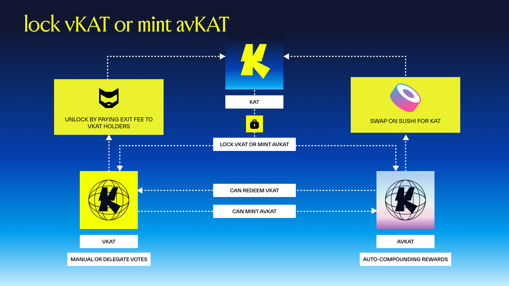

# What Is vKAT? KAT Staking and Vote-Escrow Explained

## vKAT Staking & Voting

### What is Katana's staking and voting system?

Katana's staking system lets KAT holders participate in how incentives are distributed across DeFi on Katana. Users can stake KAT for vKAT and vote on which eligible markets and liquidity pools receive incentives, and those votes help determine where emissions are directed during each voting epoch. Users who prefer a more automated approach can participate through avKAT, which delegates voting and reward management to an automated strategy. Together, vKAT, avKAT, gauge voting, and reward distribution form Katana's chain-wide system for coordinating incentives and liquidity.

### How does voting work?

Katana distributes incentives through recurring voting epochs. vKAT holders vote for eligible markets and pools, and the amount of voting power directed toward each market helps determine how Katana incentives are allocated during that epoch. Protocols can also provide additional incentives to attract votes, giving applications a way to compete for liquidity while rewarding the KAT holders who help direct it. This creates a shared incentive system across Katana rather than requiring every application to build its own independent tokenomics model.

### What is ve(3,3)?

Katana's staking system is inspired by the **ve(3,3)** model used across DeFi. The "ve" component refers to **vote-escrowed tokens**, where users lock or stake tokens in exchange for voting power over how incentives are distributed. Katana extends this concept across the broader ecosystem, allowing voting power to help direct incentives between DeFi markets throughout the network.

### What role does Aragon play?

[Aragon](https://aragon.org) built much of the infrastructure powering Katana's staking and voting system. This includes the vKAT and avKAT interfaces, epoch voting infrastructure, incentive claiming, indexing and backend systems, and automation for voting, compounding, and reward routing. Aragon also provides tokenomics and infrastructure support as the system evolves.

---

## KAT, vKAT & avKAT

KAT can be staked in two ways: directly through vKAT, where you control your voting and rewards, or through avKAT, which automates voting and compounding through a managed strategy.

### What is KAT?

KAT is the native token of Katana. It is transferable and can be held in any Ethereum-compatible wallet. Holding KAT by itself does not provide voting power. To participate in Katana's incentive voting system, KAT must be staked through vKAT or avKAT.

### What is vKAT?

vKAT (voting KAT) is the **non-transferable NFT** you receive when you lock KAT. Each vKAT NFT represents a locked KAT position and carries voting power based on the amount of KAT locked. vKAT holders have direct control over their position: they can vote on which eligible pools and markets receive KAT incentives, claim rewards, and choose how those rewards are paid out, including USDC, WETH, WBTC, KAT, or a custom mix. Because each locked position is represented by its own NFT, users can hold and manage multiple vKAT positions.

### What is avKAT?

avKAT (autocompounding voting KAT) is a **liquid, transferable token** that provides an automated way to participate in the vKAT system. When KAT is deposited into avKAT, the vault locks the underlying KAT as vKAT and manages the position on the user's behalf, with its strategy handling voting, reward collection, and compounding automatically. Instead of receiving rewards that need to be claimed manually, value is compounded back into the strategy, increasing the amount of KAT represented by each avKAT over time. avKAT also acts as a tokenized relayer, allowing voting power to be delegated to an automated strategy while giving users a liquid token representing their position.

### What is the difference between vKAT and avKAT?

| Feature | vKAT (Direct) | avKAT (Automated) |
|---------|---------------|-------------------|
| **Token Type** | Non-transferable NFT | Liquid, transferable token |
| **Voting** | You choose where to vote | Managed automatically by the strategy |
| **Reward Claiming** | Manual | Automated |
| **Reward Preferences** | Customizable | Managed by the strategy |
| **Compounding** | Manual | Automatic |
| **Liquidity / Exit** | 60-day cooldown | Can be traded on available DEX markets or redeemed through the standard exit process |
| **Best For** | Users who want direct control over voting and rewards | Users who prefer automated voting and compounding |

---

## Staking & Participation

### What are the two ways to participate?

1. **vKAT (Direct participation)** — Lock KAT for vKAT and manage your voting, rewards, and voting preferences yourself.
2. **avKAT (Automated participation)** — Deposit KAT into avKAT and delegate voting, reward collection, and compounding to an automated strategy.

Both participate in the same underlying staking and voting system. The main difference is how much control and management the user wants.

### What is a relayer?

A relayer manages voting on behalf of users who delegate their voting power to it. Instead of choosing gauges and managing votes yourself, you can delegate that responsibility to a relayer following a defined strategy. avKAT is the first tokenized relayer in the Katana system, automating voting, reward collection, and compounding while issuing avKAT as a liquid representation of the underlying position. The relayer system is open, allowing additional strategies to be introduced over time, which could allow vKAT holders to choose between different relayers based on how they want their voting power managed.

### How do I stake KAT to get vKAT?

Lock KAT through the [Katana staking app](https://app.katana.network/stake) to receive a vKAT NFT. Each NFT represents a separate locked position, so you can hold multiple vKAT NFTs and manage each position independently.

### How do I get avKAT?

Deposit KAT into the avKAT vault through the [Katana staking app](https://app.katana.network/stake). The vault locks the underlying KAT into vKAT and issues avKAT representing your share of the vault. From there, the strategy manages voting, reward collection, and compounding automatically.

### Can I convert between vKAT and avKAT?

Yes. You can deposit an existing vKAT NFT into the avKAT vault and receive avKAT in return. The original vKAT position becomes part of the vault and is managed by the avKAT strategy. To move in the other direction, avKAT can be redeemed into a new vKAT position, which can then be managed directly or exited through the standard vKAT withdrawal process.

### Can I merge or split vKAT positions?

Yes. Multiple vKAT positions can be merged into a single NFT, and a vKAT position can also be split into multiple NFTs. This gives users flexibility over how they organize, delegate, vote with, or eventually exit their locked KAT positions.

---

## Gauge Voting, Incentives & Rewards

### How does gauge voting work?

Gauge voting lets vKAT holders decide where KAT incentives are directed across DeFi on Katana. Each eligible market or liquidity pool has a gauge, and vKAT holders allocate their voting power across the gauges they want to support using percentages. The amount of voting power each gauge receives helps determine how KAT incentives are distributed during that epoch. Votes remain in place across epochs until you change them or delegate your voting power to a relayer. Over time, gauge voting can support different types of DeFi markets across Katana, including spot liquidity, lending, perpetuals, and other yield-generating applications.

### What is the incentive flywheel?

Gauge voting is designed to create a cycle between incentives, liquidity, and protocol activity: **KAT incentives attract liquidity → deeper liquidity supports more activity → activity generates fees → fees and vote incentives reward participants**. Protocols benefit by attracting liquidity, liquidity providers earn incentives and fees, and vKAT holders help determine where incentives are directed and can earn rewards for their participation. This gives protocols a way to compete for liquidity while giving KAT stakers a role in deciding where incentives are most valuable.

### What rewards do vKAT voters earn?

vKAT holders **direct** KAT incentives, but those KAT incentives are generally earned by liquidity providers participating in the selected markets. vKAT voters can instead earn rewards associated with the gauges they support, including:

- **Vote incentives** — Additional rewards offered to encourage votes toward a particular gauge.
- **Protocol or trading fees** — Fees generated by eligible markets that are distributed to voters.
- **Exit fees** — Value redistributed from users exiting vKAT positions.

The exact rewards available can vary depending on the gauge.

### What tokens are rewards paid in?

Reward tokens depend on where the rewards come from. For example:

- **Protocol or trading fees** may be paid in assets such as USDC, WETH, or other tokens generated by the market.
- **Vote incentives** are paid in whatever token the incentivizing protocol chooses to offer.
- **Exit fee rewards** are distributed through the vKAT system.

!!! note "Custom reward-token selection is not currently available"
    vKAT holders claim the rewards generated by the gauges they vote for. avKAT holders do not need to manage individual reward tokens because the avKAT strategy handles claiming and compounding automatically.

### How are rewards distributed?

Eligible rewards are distributed each epoch through [Merkl](https://app.merkl.xyz/status). vKAT holders can claim their rewards through the Katana app, while avKAT holders have rewards claimed and managed automatically by the vault and compounded back into the strategy.

---

## Exiting vKAT

### How do I exit a vKAT position?

When you begin withdrawing a vKAT position, a **60-day cooldown** starts. During the cooldown the position has no voting power, no longer earns voting rewards, and its existing votes are removed. After completing the full 60-day cooldown, the position can be withdrawn with a **2.5% exit fee**. If you change your mind during the cooldown, you can cancel the withdrawal and return the position to active staking.

### Can I exit before the 60-day cooldown ends?

Yes. You can withdraw before the cooldown is complete by paying a higher exit fee. The fee decreases over the 60-day period:
<!-- TODO: switch back when cooldown becomes 45 days:
Yes. You can withdraw before the cooldown is complete by paying a higher exit fee. The fee decreases over the 45-day period:
-->

| Time Since Starting Exit | Exit Fee | Example: 1,000 KAT |
|--------|-----|---------------------------|
| **Day 0** | 25% | Receive 750 KAT |
| **Day 15** | ~19.4% | Receive ~806 KAT |
| **Day 30** | ~13.8% | Receive ~863 KAT |
| **Day 45** | ~8.1% | Receive ~919 KAT |
| **Day 60** | 2.5% | Receive 975 KAT |

Waiting longer reduces the fee, with the minimum fee reached after the full cooldown.

### Where do exit fees go?

Exit fees are redistributed to active vKAT participants, rewarding users who remain staked in the system.

### How do I exit an avKAT position?

Two options:

1. **Trade avKAT on a DEX** — Because avKAT is transferable, it can be exchanged through available DEX liquidity without waiting for the vKAT cooldown. The price received will depend on available liquidity and market conditions.
2. **Redeem through the avKAT vault** — avKAT can be redeemed into a new vKAT position. From there, the standard vKAT withdrawal process, including cooldown and exit fees, applies.

## Risks

### What are the main risks of staking KAT?

Staking KAT through vKAT or avKAT involves several risks:

- **Smart contract risk** — Bugs or exploits could affect the staking, vault, gauge, or supporting contracts.
- **Voting concentration** — A relatively small number of large holders or strategies could control a significant portion of voting power.
- **avKAT liquidity risk** — Selling avKAT immediately depends on available DEX liquidity and may involve slippage or trading below the value of the underlying position.
- **Exit fee risk** — Exiting vKAT before the full cooldown can result in a significant fee.
- **Strategy risk** — avKAT relies on an automated voting and compounding strategy whose performance may change over time.

### How are these risks managed?

Several mechanisms are designed to reduce risk and encourage long-term participation:

- **Cooldowns and exit fees** discourage rapid withdrawals and redistribute exit fees to remaining participants.
- **Relayers** allow users to delegate voting rather than manage every gauge themselves.
- **Multiple sources of network and DeFi revenue** can contribute to incentives and rewards, reducing reliance on KAT emissions alone.
- **The DeFi Security Council** can respond to critical security situations through its emergency governance powers.

---

## Learn More

For a deeper look at the design of Katana's staking and voting system, the Aragon partnership, and the infrastructure behind vKAT and avKAT, read the full blog post: [What Is vKAT? Vote Escrow and Governance on Katana](https://katana.network/blog/katana-x-aragon-inside-the-vkat-armory).
