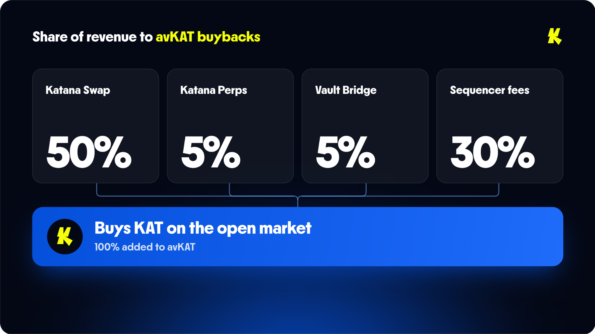
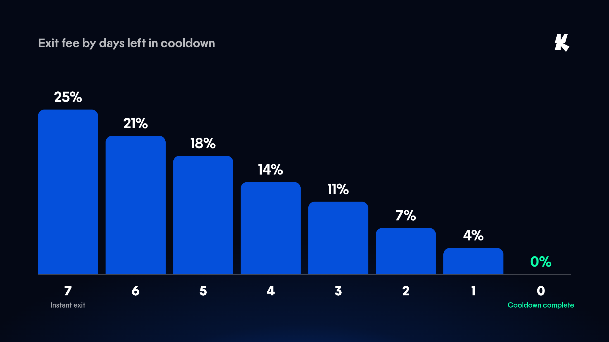

# How KAT Staking Works: avKAT and Revenue-Funded Buybacks

## Staking Overview

### What is KAT staking?

When you stake KAT, the avKAT vault issues **avKAT** tokens, a liquid, transferable token representing a proportional percentage of the vault's staked position. A share of the revenue Katana earns from its own venues is used to buy KAT on the open market, and **100% of that KAT is compounded into avKAT**.

There is nothing to claim and nothing to restake. Rewards compound into avKAT automatically every epoch.

### Where does the revenue come from?

Katana owns and operates the venues behind its core financial markets, so the revenue they generate can flow back to the network instead of to third-party operators. A share of the fees from each of these funds KAT buybacks:

- **Katana Swap:** the Sushi deployment on Katana, for trading tokens.
- **Katana Perps:** perpetual futures trading, built by the IDEX team, which Katana acquired.
- **Vault Bridge:** assets bridged to Katana keep earning yield on Ethereum. See [Vault Bridge](core-concepts/vault-bridge.md).
- **Sequencer fees:** fees paid for transactions processed on Katana.

The share of each revenue source that goes to KAT buybacks is 50% of Katana Swap revenue, 5% of Katana Perps revenue, 5% of Vault Bridge revenue and 30% of sequencer fees. 100% of the KAT bought back is compounded into avKAT.

*Share of revenue to avKAT buybacks. Actual buybacks vary with network activity.*

The amount of KAT bought back depends on how much the network is used. More trading, bridging and network activity means more revenue for buybacks. Less activity means less.

### How are buybacks carried out?

At launch, buybacks follow a scheduled process. Fully automated onchain buybacks are planned once the security and engineering work is complete.

### How does the avKAT exchange rate work?

avKAT represents a proportional percentage of the vault's staked position. When you stake, you receive avKAT at the current exchange rate between avKAT and KAT. Bought-back KAT is compounded into avKAT every epoch, which raises the amount of KAT each avKAT can be redeemed for. Your avKAT balance stays the same.

For example, if 1 avKAT can be redeemed for 1.05 KAT today and bought-back KAT is then compounded into avKAT, the same 1 avKAT might later be redeemable for 1.06 KAT.

The exchange rate is measured in KAT. It says nothing about the market price of KAT or avKAT, which can go up or down.

---

## Staking & Participation

### How do I stake KAT?

Deposit KAT into avKAT through the [Katana staking app](https://app.katana.network/stake). You receive avKAT in return, and rewards compound into it automatically every epoch.

Developers can follow the [Stake KAT to avKAT](how-to/kat-deposit-to-avkat.md) walkthrough.

### Is avKAT transferable?

Yes. avKAT is a standard, transferable token. You can hold it in any Ethereum-compatible wallet, send it to another wallet, or trade it on available DEX markets.

### Do I need to claim rewards?

No. Rewards are compounded into avKAT automatically every epoch, so there is nothing to claim or restake.

### I still have vKAT. What should I do?

vKAT stopped earning rewards when it was sunset. To start earning again, convert your vKAT to avKAT in one click in the [Katana staking app](https://app.katana.network/stake). You can convert at any time, before or after November 17, 2026, with no deadline.

Conversion happens at the current exchange rate between avKAT and KAT. Because each avKAT can currently be redeemed for more than 1 KAT, you may receive **fewer avKAT tokens** than the amount of KAT in your vKAT position. Your avKAT is backed by the same amount of KAT you converted.

Developers can follow the [Convert vKAT to avKAT](how-to/kat-convert-vkat-to-avkat.md) walkthrough.

### Can projects still offer vote incentives?

No. Vote incentives ended with gauge voting on November 17, 2026.

### How are liquidity incentives on Katana decided now?

With gauge voting sunset, KAT liquidity incentives for pools on Katana are allocated by the Katana Foundation. See [Stake Your Liquidity Position](stake-lp.md).

---

## Exiting avKAT

### How do I exit an avKAT position?

You have two options:

1. **Unstake through the cooldown.** Start a withdrawal and wait the **7-day cooldown**. If you wait the full 7 days, there is **no exit fee**. You can also leave early by paying an exit fee that goes down each day (including an instant exit for a 25% fee).
2. **Swap avKAT for KAT on a DEX.** This is instant, but it happens at the market rate and may involve trading fees, price impact and slippage.

### What is the exit fee if I leave early?

The exit fee starts at 25% and goes down every day of the cooldown until it reaches 0%:

| Time left in cooldown | Exit fee | Example: 1,000 KAT |
|---|---|---|
| **7 days** (instant exit) | 25% | Receive 750 KAT |
| **6 days** | 21% | Receive 790 KAT |
| **5 days** | 18% | Receive 820 KAT |
| **4 days** | 14% | Receive 860 KAT |
| **3 days** | 11% | Receive 890 KAT |
| **2 days** | 7% | Receive 930 KAT |
| **1 day** | 4% | Receive 960 KAT |
| **Cooldown complete** | 0% | Receive 1,000 KAT |

Waiting for the full cooldown means you receive all of your KAT.

### Can I cancel an exit?

Yes. If you change your mind during the cooldown, you can cancel the withdrawal and return to staking.

For developer instructions, see [Unstake and Exit](how-to/kat-unstake-and-exit.md).

---

## Risks

### What are the main risks of staking KAT?

- **Smart contract risk:** bugs or exploits could affect the avKAT vault or supporting contracts.
- **Variable rewards:** buybacks depend on protocol revenue and network activity. Rewards are not guaranteed and will go up or down with usage.
- **avKAT liquidity risk:** swapping avKAT on a DEX depends on available liquidity and may involve slippage or a price below the value of the underlying KAT.
- **Exit fee risk:** leaving before the 7-day cooldown is complete results in an exit fee of up to 25%.
- **Program changes:** the staking and buyback program may be modified or ended.

### How are these risks managed?

- **A short cooldown with a declining fee** lets you choose between waiting 7 days for a fee-free exit or leaving earlier for a fee.
- **Multiple revenue sources** (trading, perps, bridging and sequencer fees) reduce reliance on any single source.
- **The DeFi Security Council** can respond to critical security situations through its emergency governance powers. See [Governance](core-concepts/governance.md).

!!! info "KAT staking changed on November 17, 2026"
    vKAT staking, gauge voting and vote incentives were sunset on November 17, 2026. **avKAT is now the way to stake KAT.** If you still hold vKAT, you can [convert it to avKAT](how-to/kat-convert-vkat-to-avkat.md) at any time. There is no deadline.

    

---

## Learn More

- [KAT Tokenomics Update: avKAT and Katana Revenue](https://katana.network/blog/kat-tokenomics-update-avkat-katana-revenue) on the Katana blog.
- [Understanding the KAT Token Ecosystem](how-to/kat-token-overview.md): KAT and avKAT in detail.
- [Tokenomics & Schedules](core-concepts/what-is-kat/tokenomics.md): how the KAT supply is allocated.

!!! note "Disclaimer"
    This page is for information only and is not investment, legal or tax advice. Rewards vary with protocol usage and are not guaranteed. The staking and buyback program may be modified or terminated without notice.
