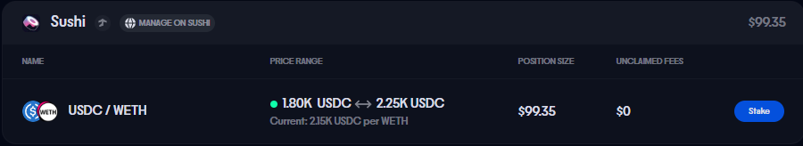
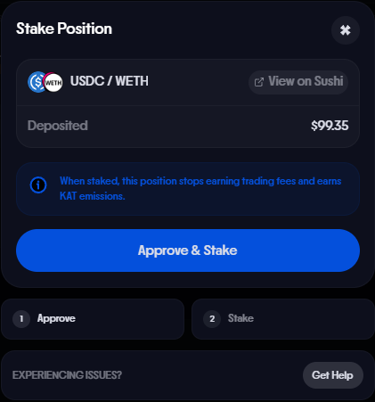

# Stake Your Liquidity Position

Liquidity providers can stake eligible LP positions on Katana to earn KAT incentives. KAT incentives are distributed through Katana's gauge voting system. vKAT holders vote on which eligible liquidity pools receive incentives, and liquidity providers in those pools can earn KAT based on their eligible liquidity.

## What You Need

- An eligible liquidity position on Katana
- A wallet connected to the [Katana app](https://app.katana.network/portfolio)

## How to Stake Your Liquidity Position

1. Go to the [Katana Portfolio page](https://app.katana.network/portfolio).
2. Find the liquidity position you want to stake.
3. Select **Stake**.
{ .img-left }
4. If required, **approve** the staking contract to access your position.
{ .img-left }
5. **Confirm** the staking transaction in your wallet.
6. Once the transaction is confirmed, your position will begin participating in KAT incentive distribution.

## How KAT Rewards Work

Staking makes your liquidity position eligible to receive KAT incentives. The amount of KAT directed to each eligible pool is determined through gauge voting. vKAT holders allocate voting power across gauges, which helps determine how KAT incentives are distributed each epoch. The amount an individual liquidity provider earns depends on factors including:

- The amount of KAT incentives directed to the pool
- The amount of eligible liquidity participating in the pool
- Your share of that eligible liquidity

For more information, see [Gauge Voting, Incentives & Rewards](katana-staking.md#gauge-voting-incentives-rewards).

## Your Position Must Be In Range

For concentrated liquidity pools, only liquidity that is **in range** is eligible to earn trading fees and KAT incentives. If the market price moves outside your selected price range, your position will stop earning until either the price moves back into your range, or you rebalance your position around the current market price.

!!! info "Staking alone does not guarantee rewards"
    Your position must also meet the eligibility requirements of the pool.

## Rebalancing Your Position

If your liquidity position moves out of range, you may choose to rebalance it. This generally involves unstaking the existing position, removing the liquidity, creating a new position around the current market price, and staking the new position. Rebalancing changes your price range and can expose you to different risks and market conditions.

For a developer walkthrough with full code examples using viem and wagmi, see the [Rebalance Your Staked LP Position](how-to/lp-rebalance-guide.md) tutorial.
